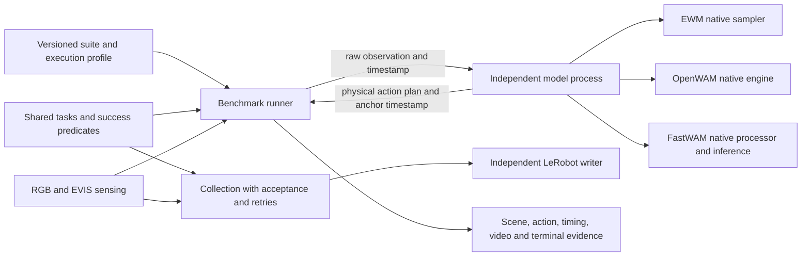

# Benchmark and policy boundaries

`piper_bench` owns simulation, task definitions, sensing, scene sampling, action
scheduling and physical success predicates. `piper_policies` owns checkpoint
loading, normalization, inference and optional prediction decoding. The two
packages communicate through a timestamped, pickle-free WebSocket protocol.

Task registration and CPU scene planning do not import Isaac. The backend starts
Isaac before simulator-dependent imports, binds the verified Piper asset bundle,
and installs the versioned compatibility layer. A separate deployment lock fixes
Python/native-package versions and third-party commits. Hardware allocation is
kept in `launch/slurm`; it never changes the task profile.

The suite records the eight current collection versions, success versions,
calibrations and fixed budgets. The default executor is 30 Hz continuous/min8;
the default background is grey-green v5. A saved scene list fixes every trial
and retries remain zero during evaluation. Collection retains its separate
acceptance, retries and successful-demonstration export logic.

`evaluation/controllers.py` contains the sole serial, buffered and continuous
controller implementations. Their migration is checked against fingerprints
generated from the original source, including zero latency, expiry, hold actions,
and irregular reply delays. Legacy simulator modules alias the canonical modules;
old source snapshots are preserved rather than silently upgraded.

The policy descriptor pins model/config/statistics/source hashes and input/output
shapes. Returned plans must echo the submitted observation time and step. Model
configuration parsing happens only in the policy environment. Actual compilation,
warmup and cache settings are reported separately from the immutable descriptor.
Recorded predictions are decoded after trials; a policy without that capability
advertises it and records no forecast video.

The OpenWAM adapter recognizes the Piper legacy normalization keys `eef` (7D)
and `state` (8D), and translates only `state` to native `eef_state` in a temporary
copy. Native normalization math remains responsible for scaling and action
decoding. The descriptor records the mapping and source/effective hashes;
canonical statistics remain byte-identical and unknown schemas are rejected.
The checkpoint and original statistics are never rewritten.

Dataset paths are provenance, not identity. Supplied exports still undergo
version, camera, geometry and timing checks. EWM's legacy collection SHA hashes
the exact metadata JSON bytes. Optional `piper_training_data_v1` manifests can
also provide a `metadata_identity` per task covering collection, calibration and
temporal JSON. Neither identity hashes every video/trajectory; legacy size/mtime
signatures are explicitly labeled and never promoted to full content checksums.

Replay has two explicit modes: CPU terminal rejudging and actual GPU-rendered
fixed-action simulation. Only the latter marks `simulation_executed: true`.
The original result is read-only, a new output directory is required, and the
replay report retains input hashes, initial-state differences, terminal deltas
and video/event evidence. See [migration-validation.md](migration-validation.md)
for which checks have actually completed.
