# Event 与 RGB latent 表征分析：分布、可预测性和 PCA 重建

记录日期：2026-11-04。本文整理已有实验与用户提供的分析，不代表新增训练或正式闭环评测。原始意见见 [用户分析原文](user_analysis_original.md)；如原文与本报告口径不一致，以本报告及代码、数据为准。

## 研究问题与主要结论

本实验比较冻结 VAE 编码出的 Event 与 RGB latent 的统计结构、线性可压缩性，以及 PCA 重建后经 VAE decoder 还原的质量。实验不训练或调用 EWM，不能直接得出 Event 更容易预测、控制成功率更高或更适合动态任务的结论。

在当前数据、编码方式和轨迹划分下，Event latent 的总体方差与 PCA 有效秩通常较低；在八个任务的混合阶段 PCA 中，Event 在相同主成分数下的训练方差解释率和留出轨迹重建保留率均高于 RGB。但传送带末尾窗口的有效秩以及部分按阶段拟合的留出结果出现反例，因此不能把这个排序推广到所有阶段。

落球任务的 decoder 检查显示，PCA 压缩后活动事件检出 F1 低于无压缩 VAE 基线，末尾阶段下降尤其明显。潜空间解释方差不能替代活动事件重建质量；活动事件 F1 也不能替代球的位置、速度和轨迹指标。训练集 K=32 保留 95.64% 方差，而同一模型的留出集保留率是 85.00%；不能将前者当成 decoder 检查样本的方差保留率。

## 数据、模型与划分

- 使用八个任务各 50 条轨迹、每条轨迹的起始和末尾两个完整未来窗口，共 400 条轨迹、800 个窗口。每任务在配对的轨迹、时刻和相机 cam0 上提取 Event 与 RGB latent；两种输入采用各自预处理，并用现有冻结 VAE 编码。输入不同使方差数值和解码误差不宜直接跨模态解释为统一质量单位。
- 每个样本原有四个 latent 块；仅取三个未来块并展平为 49,152 维向量。PCA 是**每任务、每模态对整个展平向量拟合**，不是对每个空间位置独立拟合。
- 按轨迹排序，前 40 条用于拟合，后 10 条留出测试。同一轨迹的起始、末尾窗口始终归入同一组，避免窗口级随机划分泄漏。窗口可能重叠，轨迹排序可能影响划分；测试轨迹只相对 PCA 拟合独立，不能声称对正式 EWM 训练也独立。
- 混合阶段拟合使用 80 个训练窗口，中心化样本秩至多 79。分阶段拟合分别使用 40 个训练窗口，秩至多 39，故分阶段不报告 K=64。有限样本上求得的谱、有效秩和训练 K95 都受此上限影响。

## 原有总体统计

跨样本平均方差按每个 latent 坐标分别在样本维中心化后求平方平均，再对坐标平均；它依赖输入与编码数值尺度。PCA 谱有效秩刻画样本协方差谱的集中程度，对统一尺度缩放不敏感，但不是整个分布的内在维度。

| 任务 | Event/RGB 方差比 | Event 有效秩 | RGB 有效秩 |
|---|---:|---:|---:|
| conveyor | 0.342 | 9.56 | 26.27 |
| moving_carton | 0.233 | 16.17 | 39.29 |
| turntable_cups | 0.325 | 6.56 | 21.87 |
| rotating_tube | 0.245 | 6.58 | 21.61 |
| tennis_rolling | 0.160 | 9.31 | 36.95 |
| tennis_falling | 0.263 | 6.26 | 32.86 |
| tennis_parabolic | 0.245 | 29.02 | 57.90 |
| tennis_container | 0.324 | 29.54 | 50.27 |

八任务等权平均有效秩约为 Event 14.1、RGB 35.9，仅描述本批样本。按阶段查看时，所有任务两阶段 Event 方差均低于 RGB，但 conveyor 末尾 Event/RGB 有效秩为 47.54/45.37，Event 略高。将其 50 条轨迹不放回抽取 25 条、重复 200 次，排序均存在；这些重叠子集不能代替独立数据验证。

落球混合窗口总体方差中，起始和末尾窗口组均值差贡献 Event 61.0%、RGB 32.7%。阶段差异会主导部分谱结构，这一统计分解不证明产生差异的因果机制。

## 统计与二维可视化

- [八任务方差和有效秩绝对值](figures/latent_metrics_all_tasks.png)及[按阶段的比值热图](figures/latent_metrics_by_stage.png)：热图的红框是 conveyor 末尾有效秩反例；图中合并组有 100 个相关窗口，单阶段有 50 个窗口，样本秩上限分别为 99 和 49，不宜用绝对秩跨阶段比较。
- [归一化 PCA 累计谱](figures/spectral_curves.png)：落球合并窗口中，Event 前 13 个主成分与 RGB 前 69 个分别覆盖各自样本方差的 90%；conveyor 末尾分别为 43 和 42。该图归一化后只比较谱形状，不表达绝对方差。
- [落球起末阶段方差分解](figures/falling_variance_decomposition.png)：混合方差中的组间均值差贡献分别为 Event 61.0%、RGB 32.7%。
- [50 轨迹 PCA 全任务图](figures/pca_all_tasks.png)和[落球图](figures/pca_tennis_falling.png)：每模态独立拟合且同任务使用相同绘图尺度。独立 PCA 的坐标方向不同；二维只能显示部分方差，不能从图上点云面积判断完整高维分布。
- [落球 t-SNE](figures/tsne_tennis_falling.png)、[传送带 t-SNE](figures/tsne_conveyor.png)是探索性自实现，已有数值梯度检查，但未与成熟实现交叉验证或系统检查收敛；不同图之间的簇面积及距离不能用于定量比较。较早的 [5 轨迹 PCA](figures/latent_pca.png)和[小样本 ridge 图](figures/ridge_relative_mse.png)仅供追溯，不代替 50 轨迹结果。

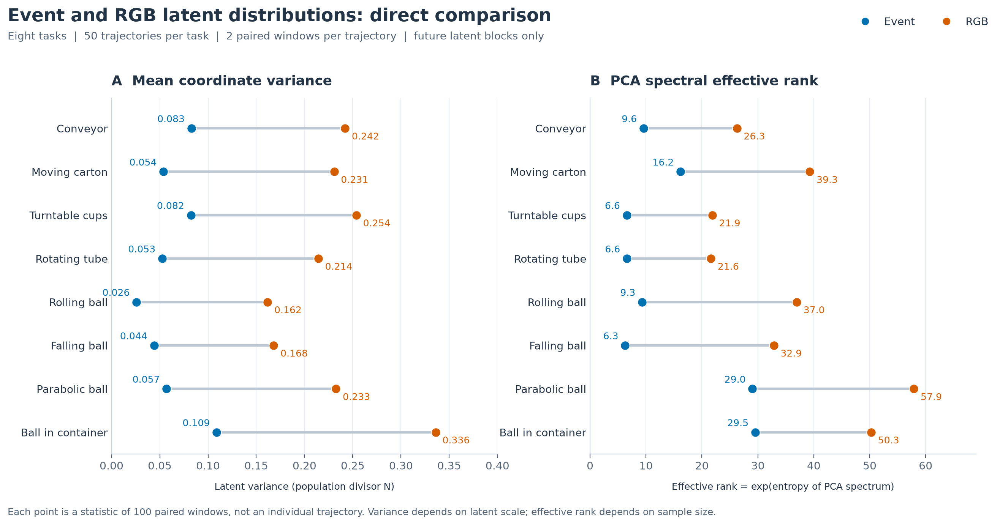

### 输入稀疏性的理论解释及其边界

若将归一化双极性事件帧记为 $e\in[0,1]^d$，其非零元素比例为 $\rho$，伪 RGB 映射为 $P(e^-,e^+)=(e^-,(e^-+e^+)/2,e^+)$，且假设理想实值 VAE 编码映射 $f$ 在相关区域是 $L$-Lipschitz，则可推出

$$\operatorname{tr}(\operatorname{Cov}(f(P(e))))\le L^2\mathbb E\|P(e)\|^2\le \tfrac32L^2d\rho.$$

这描述稀疏输入如何给出 Event latent 总方差的一个上界。它依赖理想实值映射与 Lipschitz 假设，不能据此推出该上界低于 RGB 的真实方差，也不能证明两个模态的有效秩、预测难度或熵的排序。事件帧零值比例是输入统计，不等于 latent 方差。

## 整体 PCA 重建

对每任务及每模态，使用训练集均值 $\mu_{\mathrm{train}}$ 和前 $K$ 个主成分列向量 $U_K$，令 $P_K=U_K U_K^\top$，重建为

$$\hat z_K=\mu_{\mathrm{train}}+P_K(z-\mu_{\mathrm{train}}).$$

训练指标是训练集前 K 个主成分的累计方差占比。留出指标使用训练均值定义：

$$R_{\mathrm{test}}(K)=1-\frac{\sum_{i\in\mathrm{test}}\lVert z_i-\hat z_{i,K}\rVert^2}{\sum_{i\in\mathrm{test}}\lVert z_i-\mu_{\mathrm{train}}\rVert^2}.$$

该指标等于相对训练均值的测试总能量中被投影保留的比例，不是以测试均值中心化的测试方差解释率；归一化重建误差就是 $1-R_{\mathrm{test}}$。其大小受测试样本分布和训练、测试均值偏移影响。下表是落球任务：

| K | Event 训练方差保留 | RGB 训练方差保留 | Event 留出重建保留 | RGB 留出重建保留 |
|---:|---:|---:|---:|---:|
| 8 | 87.65% | 53.56% | 82.16% | 42.68% |
| 16 | 91.89% | 62.93% | 84.14% | 43.97% |
| 32 | 95.64% | 76.17% | 85.00% | 44.62% |
| 64 | 99.29% | 94.08% | 85.77% | 45.30% |

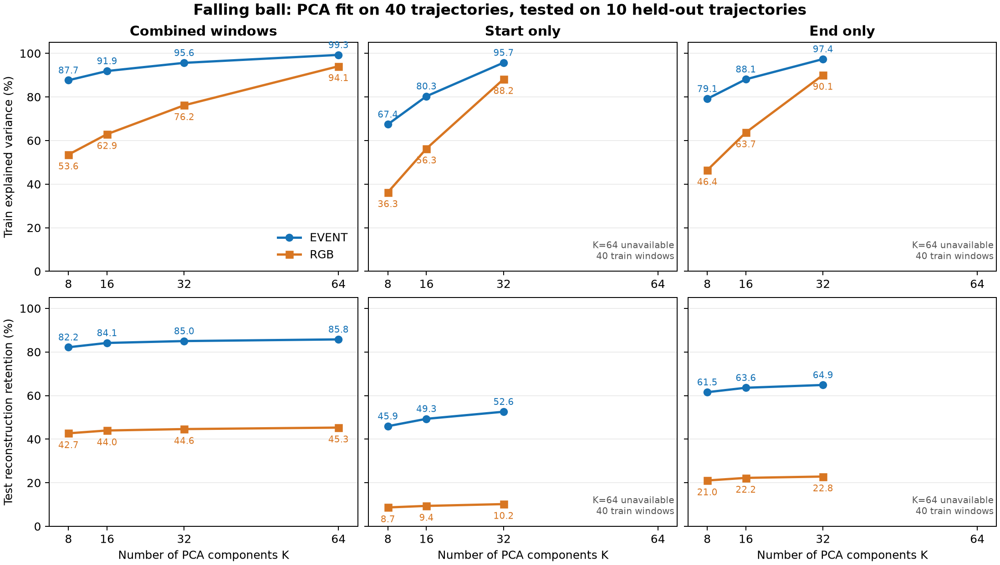

这组数据支持：在当前划分和该线性重建指标下，Event 的整体 latent 可用较少的 PCA 方向近似，且一部分结构跨留出轨迹保留。八个任务在四个 K 下混合阶段的训练及留出指标均是 Event 高于 RGB。落球的训练 K95 分别为 Event 29、RGB 67；测试集在当前可拟合的全部秩内均未达到 95%。这些是数据与编码相关的观察，不是不同模态未来预测难度的证明。

从 K=8 到 K=64，落球 Event 训练保留率由 87.65% 上升至 99.29%，留出率由 82.16% 上升至 85.77%；RGB 分别由 53.56% 至 94.08%、42.68% 至 45.30%。后续方向对当前留出集的增益有限；训练轨迹特有的变化、训练/测试分布偏移和有限样本等是候选解释，现有结果不能区分它们。RGB 结果不能直接解释成 RGB 模型泛化能力较差。

## 分阶段比较

起始与末尾窗口分别拟合独立 PCA，并使用对应阶段的留出窗口和训练均值计算保留率。落球 K=32 时：

| 阶段 | Event 训练保留 | Event 留出保留 | RGB 留出保留 |
|---|---:|---:|---:|
| 起始 | 95.7% | 52.6% | 10.2% |
| 末尾 | 97.4% | 64.9% | 22.8% |
| 起始、末尾混合 | 95.64% | 85.00% | 44.62% |

混合与分阶段实验使用不同训练样本量、测试集合和归一化分母，不能据此简单归因于阶段互补或样本量。合理的下一步是控制训练窗口数量，在相同测试集上比较单阶段与混合阶段拟合。

按阶段拟合后，K=8、16、32 时，Event 留出率在所有八个起始任务中高于 RGB；末尾窗口分别在 7、6、6 个任务中高于 RGB。conveyor 末尾 K=32 的 Event/RGB 为 4.0%/9.2%，turntable_cups 末尾为 24.2%/24.9%，提醒我们不能用混合阶段结果掩盖例外。

## 冻结 VAE decoder 检查

选用落球测试集排序最前的 4 条轨迹，每条起始和末尾窗口各一个，共 8 窗口；该选择不是随机样本，窗口不是独立轨迹。重建三个未来块、保留当前观测块不变，再由冻结 VAE 联合解码。参照的是对应原始 Event/RGB 输入，无压缩项是原始 latent 的 VAE 解码结果而非完美原图。只统计未来帧；Event 经 clip=15 归一化。

Event 活动区 MSE 仅在真实事件非零位置计算；活动 F1 以 decoder 输出至少 $1/15$ 视为活动，对比真实非零事件，每窗口计算后等权平均。RGB 像素 MSE 和 Event 活动区 MSE 使用不同内容与尺度，不应直接跨模态比较。

| 未来 latent | Event 活动区 MSE ↓ | Event 活动 F1 ↑ | RGB 像素 MSE ↓ |
|---|---:|---:|---:|
| 无压缩 | 0.0046412 | 0.76045 | 0.00014037 |
| K=8 | 0.0061284 | 0.70859 | 0.00036226 |
| K=16 | 0.0060280 | 0.70982 | 0.00032635 |
| K=32 | 0.0059889 | 0.71022 | 0.00031477 |
| K=64 | 0.0059765 | 0.71027 | 0.00030772 |

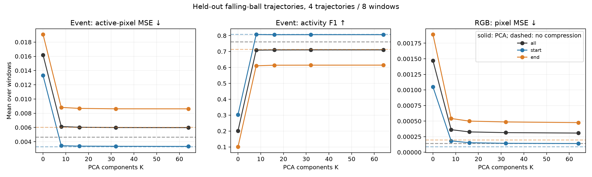

起始窗口 Event F1 在无压缩/K=32 时为 0.8075/0.8062；末尾为 0.7134/0.6143。K=8 到 K=64 的总体 F1 只上升约 0.00168，但仍低于无压缩基线；无压缩 F1 自身也低于 1，说明 VAE 本身已有误差。

该结果表明当前 PCA 投影会损失活动事件的可检出性，但不能确定损失就是物体运动信息，也不能证明是训练谱的低方差方向、跨轨迹子空间偏移或 decoder 对特定方向敏感中的哪一种。细小边缘、局部极性和特定轨迹细节可能有关，目前均为待验证假设。

## 建议诊断：均值偏移和未覆盖方向

为了判断留出能量与误差来自均值偏移还是轨迹自身变化，可以对每种模态和阶段计算测试均值 $\mu_{\mathrm{test}}$、总体形式的测试协方差 $\Sigma_{\mathrm{test}}$ 及 $\delta=\mu_{\mathrm{test}}-\mu_{\mathrm{train}}$，保持当前 PCA 子空间 $P_K$ 固定。相对训练均值的总测试能量和重建残差分别为：

$$\mathbb{E}_{\mathrm{test}}\lVert z-\mu_{\mathrm{train}}\rVert^2=\operatorname{tr}(\Sigma_{\mathrm{test}})+\lVert\delta\rVert^2,$$

$$\mathbb{E}_{\mathrm{test}}\lVert (I-P_K)(z-\mu_{\mathrm{train}})\rVert^2=\operatorname{tr}((I-P_K)\Sigma_{\mathrm{test}})+\lVert(I-P_K)\delta\rVert^2.$$

仅计算未投影的均值偏移不足以解释 PCA 重建残差；第二式还区分均值偏移中落在子空间外的部分与测试集变化中未被覆盖的部分。该诊断尚未执行，均值偏移大也不能单凭大小确定为何留出保留率低。应同时报告误差绝对量、归一化量、样本数及不确定性，结合多个轨迹划分评估稳定性。

## 早期条件预测和物理读出代理（探索性）

在 50 轨迹分布实验前，用每任务 5 条轨迹、每条起始和末尾各一个窗口做过分钟级 CPU 代理。输入是相同当前 RGB VAE latent，线性 ridge 分别预测未来 Event/RGB latent；按轨迹留一，正则只在训练折内选择。它不包含正式 EWM 的完整 DINO、文本、本体状态和联合动作条件，也没有加载 EWM checkpoint。

落球的直接预测 MSE 相对各模态训练集全局均值基线为 Event 0.6356、RGB 0.8294；与项目 flow 形式对应的高斯代理分别为 0.7992、0.9112。两模态分母不同，数值不是同尺度的跨模态预测误差。以已知起末阶段的均值作为基线时，直接预测比值变为 0.9971/0.9961。该阶段标签是事后特权信息，不代表部署时可用；结果提示原先的总体改善可能受阶段差异影响，并不能评价真实 EWM 的 flow loss。

另在落球任务上，用训练轨迹 0/10/20 的 RGB 当前 latent 预测未来 latent，再由阶段条件线性读出器估计物体位置和速度；测试轨迹为 30/40，只评估 `object_active>0.5` 的 +8、+16、+24 采样点。训练/测试分别有 15/10 个目标点，但测试只有两条独立轨迹。三维位置平均误差：阶段均值基线/Event/RGB 为 5.908/6.016/5.698 mm；速度误差为 0.031406/0.035853/0.031404 m/s。其结论限于小样本代理：没有稳定超过阶段基线的物理预测证据；这些是采样点误差，不是整段轨迹 ADE/FDE。该批轨迹来自正式训练数据，不能作为正式 EWM 的独立测试。

## 复现与材料索引

- `figures/` 保存四类统计图、PCA 和探索性 t-SNE、PCA 压缩及 decoder 图片，并保留已有 SVG/PDF 版本。图中英文标签反映原绘图环境字体。
- `data/` 保存轻量统计 JSON 和逐窗口 decoder 结果。完整 latent 缓存约 401 MB、落球 PCA 基底约 25 MB，以及原始数据和冻结权重未打包，仍需仓库本地对应缓存；因此本目录并非完整的原始数据或模型备份。
- `scripts/` 保存绘图或实验脚本。需要缓存、权重或原始视频的脚本及其输入路径见 [脚本复现说明](scripts/README.md)；不要将探索性 t-SNE 当成已验证的正式结果。
- 原始 [用户分析](user_analysis_original.md) 仅作留档；其中“逐空间位置 PCA”与实际整体展平的实现不一致，其原文中的因果与泛化判断也须按本报告限定。

本次整理复用已完成数据，无 EWM 再训练。此前落球 PCA 的独立 SVD 与显式重建核验通过；decoder 对 4 条留出轨迹、8 个窗口的 96 次解码记录与汇总 MSE/F1 已核对。完整八任务指标和轨迹 ID 保存于 `data/`。

## 论文定位与后续工作

适合作为 representation analysis 或附录的论点：当前 Event latent 的样本统计结构在多数任务及阶段更集中，在所测混合阶段划分下更易通过整体线性 PCA 近似；但较高的训练解释方差并不保证留出轨迹的活动事件质量。不能由此声称 Event 已证明更容易被 EWM 预测，或已保留足够的物体运动信息。

优先进行训练/测试能量的投影分解，并使用更多独立轨迹、控制训练样本数和评估阶段。之后可使用物体位置、速度、轨迹 ADE/FDE 等指标检查是否保留任务相关信息；真实 EWM 的论证还需要同等计算预算下的未来预测质量、动作成功率及分布外鲁棒性评测。附件提及其他稀疏 token 实验，但当前整理材料未建立可核验对应证据，不作为本实验结论。

## 图像附录

以下图像均直接嵌入报告；SVG/PDF 矢量版本及完整数据仍保留在 `figures/` 和 `data/`。任务中的两个窗口来自同一条轨迹，不能视为两条独立轨迹。

### 按阶段的统计与谱

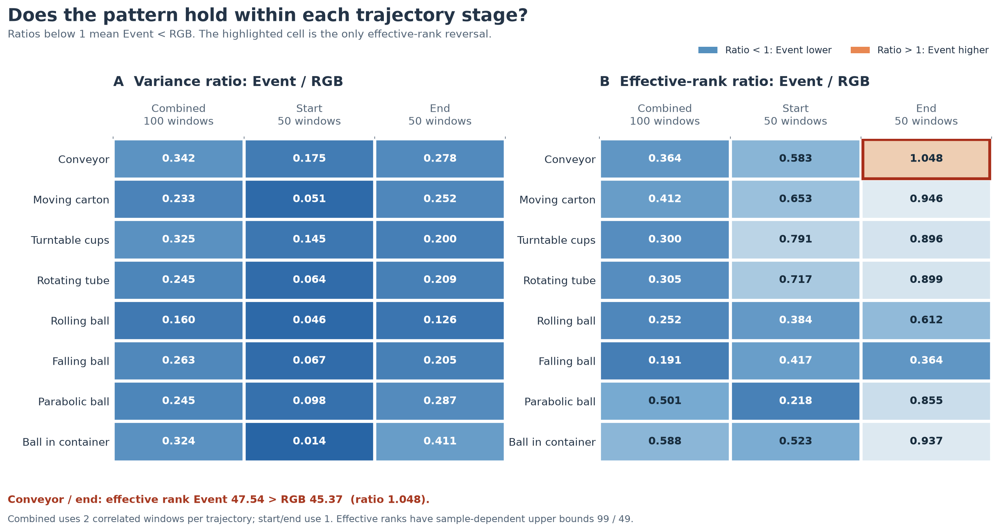

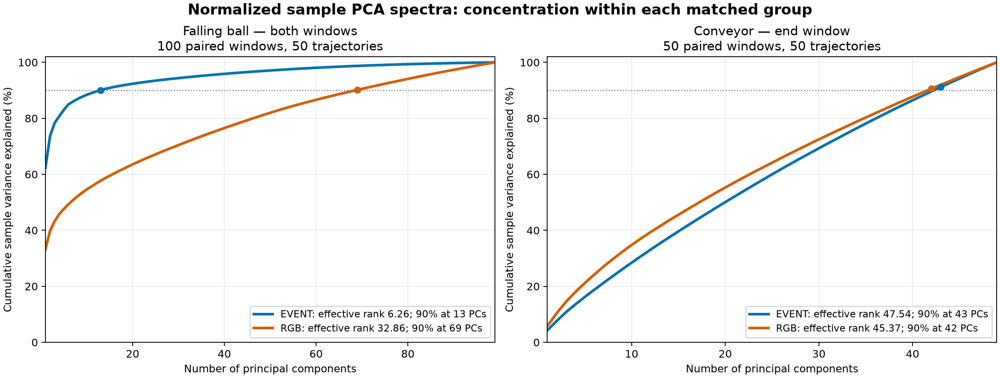

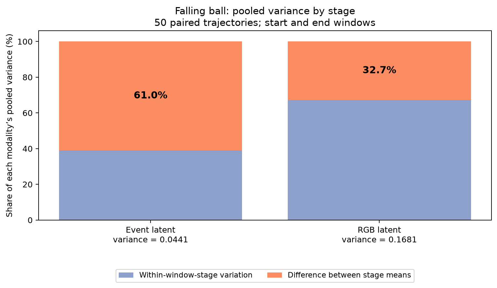

### Event 与 RGB decoder 示例

每幅图按照原始输入、未压缩 VAE、不同 PCA 维度排列。事件帧分别保留原亮度与统一增亮 4 倍的展示图；增亮仅供观察，不参与指标计算。这是一条落球留出轨迹中的单帧，不能替代多轨迹统计。

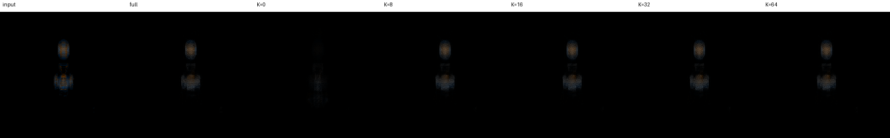

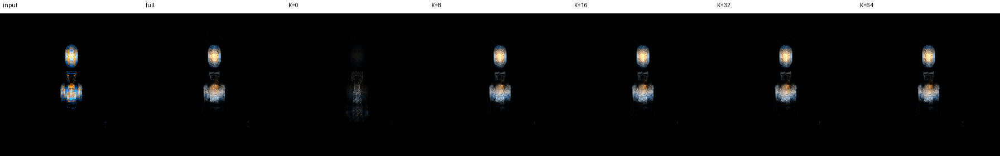

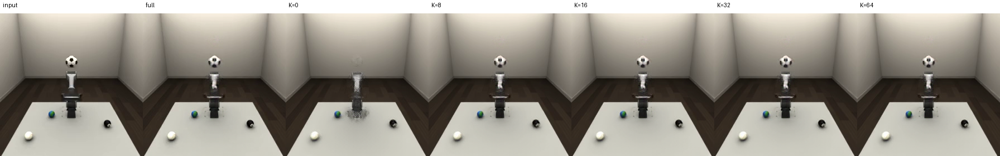

### 二维投影与历史探索图

以下图用于观察样本结构；独立拟合的 PCA 方向不同，二维面积不能作为高维分布紧凑性的定量证据。t-SNE 为自实现探索图，未与成熟实现交叉验证或系统检查收敛。早期 5 轨迹图用于溯源，不代替 50 轨迹结果。

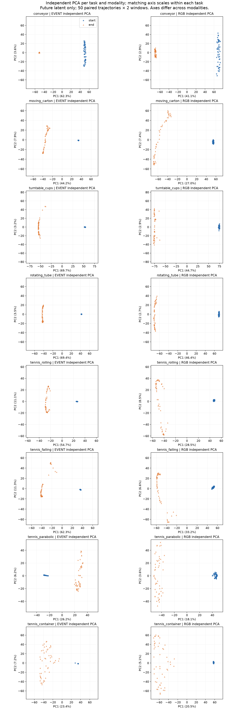

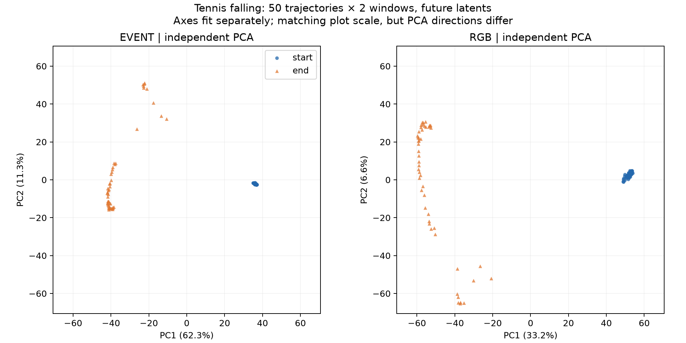

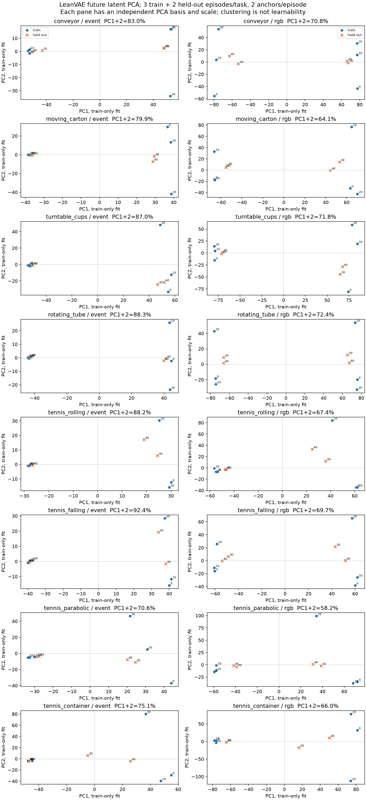

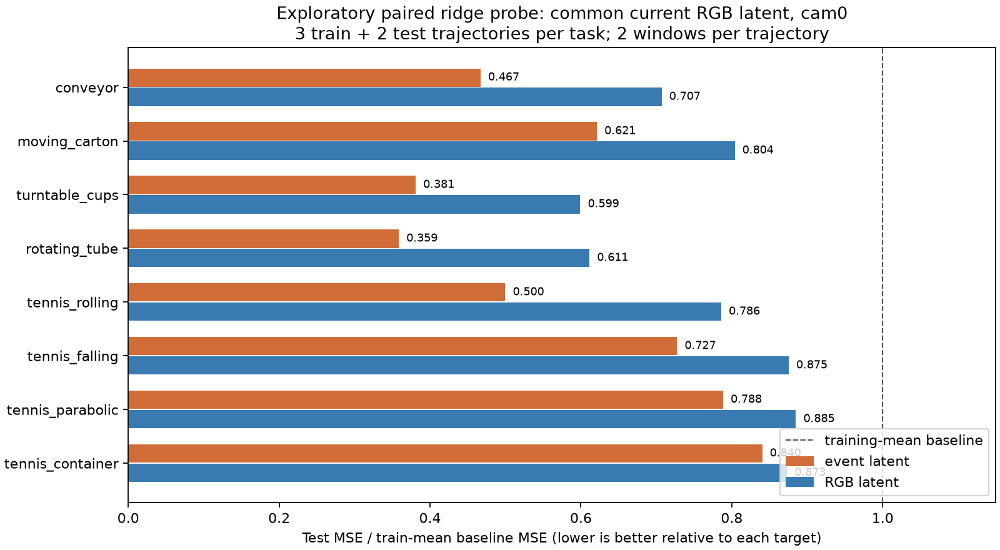

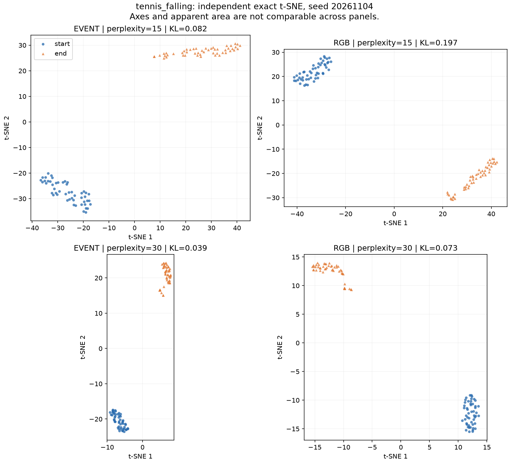

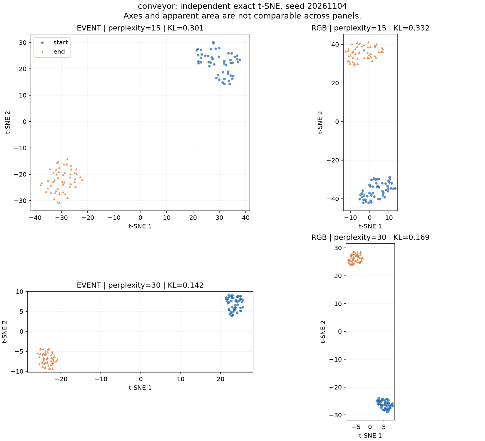
